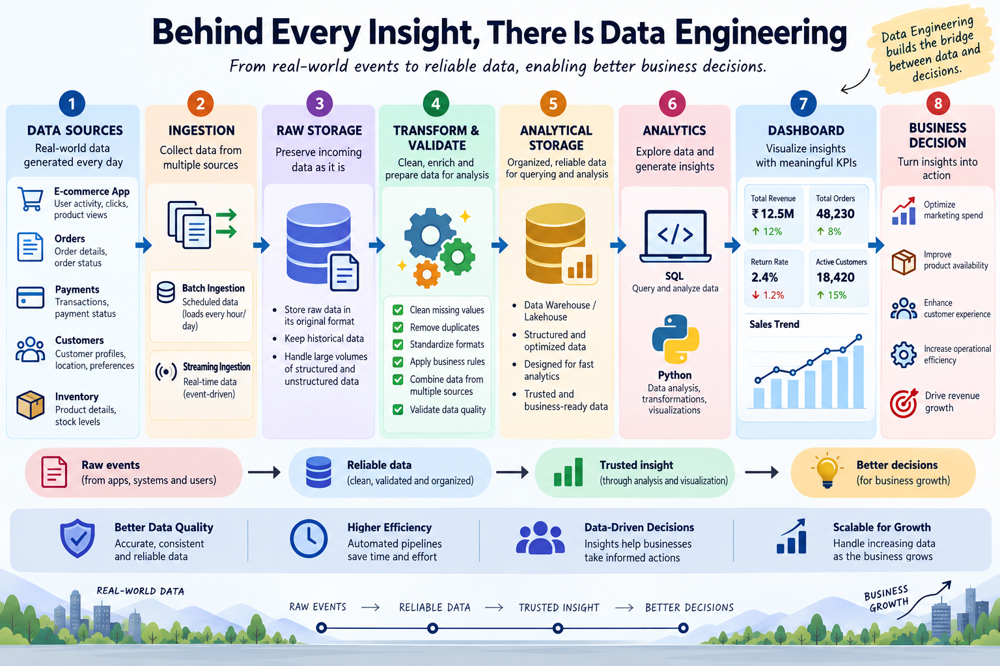
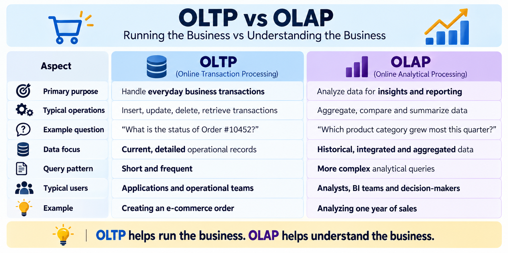
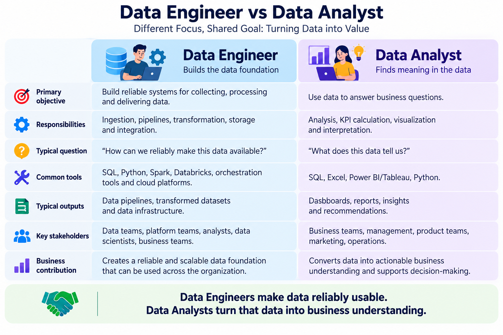
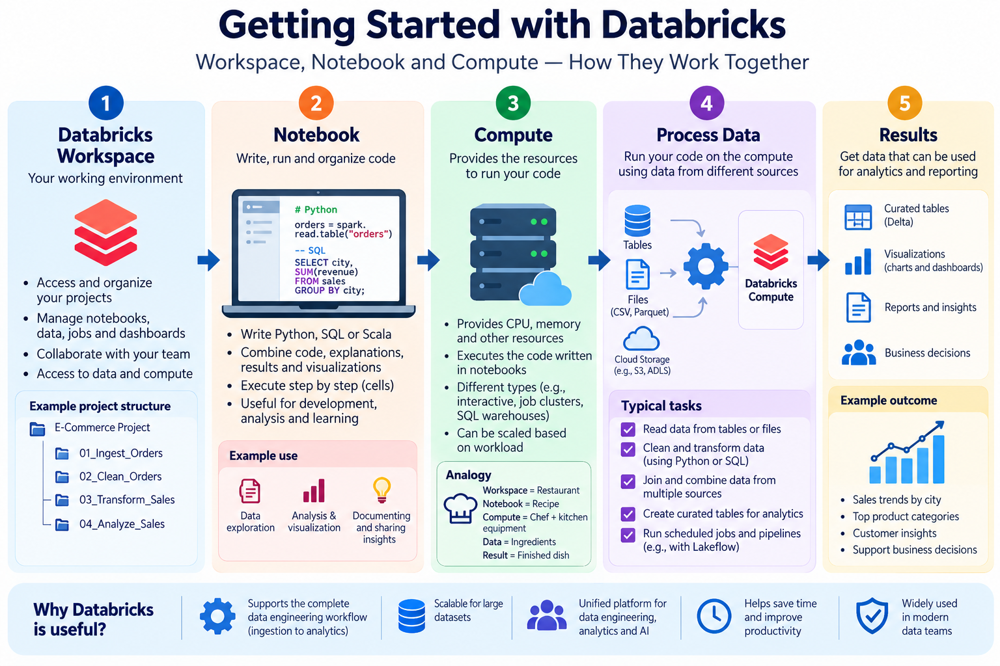

# Behind Every Insight, There Is Data Engineering

### From a Customer Click to a Business Decision — Understanding the Data Journey and Getting Started with Databricks

When a customer places an order on an e-commerce application, it may look like a simple transaction. But behind that one click, data is generated across multiple systems — orders, payments, customers, inventory, delivery, and more.

Later, a business manager might open a dashboard and ask:

> Why did footwear sales decline this month?

As someone learning Data Analytics, I usually focused on the final part of this journey — analyzing data, creating dashboards, and finding insights. Learning Data Engineering helped me understand what happens **before the data reaches an analyst**.

That is where Data Engineering begins.

---

## What Is Data Engineering?

Data Engineering is the process of **collecting, moving, storing, cleaning, transforming, and preparing data** so that it can be reliably used for analytics, reporting, machine learning, and business decisions.

A Data Engineer is responsible for building and maintaining the systems that make this possible.

A simplified data pipeline can look like:

**Data Sources → Ingestion → Raw Storage → Transformation & Validation → Analytical Storage → Analytics → Dashboard → Business Decision**

The important idea is that data rarely moves directly from a source system to a dashboard. It goes through several stages before it becomes trustworthy and useful.

---

## The Data Engineering Journey

Let's continue with the e-commerce example.

### 1. Data Sources

Data can originate from many systems, such as:

- E-commerce applications
- Customer databases
- Payment systems
- Inventory systems
- APIs
- CSV or JSON files
- Application logs
- IoT devices

Each system may store data differently.

### 2. Data Ingestion

The next step is bringing data from those sources into the data platform.

This can happen through:

- **Batch processing** — data is collected and processed at scheduled intervals.
- **Streaming** — data is processed continuously or near real time as events occur.

### 3. Raw Storage

The collected data is often stored first in its original or near-original form.

Keeping raw data can be useful because engineers may need to reprocess it later when requirements or transformation logic change.

### 4. Transformation and Validation

Raw data is rarely ready for analysis.

Data Engineers may need to:

- Handle missing values
- Remove duplicates
- Standardize formats
- Correct data types
- Apply business rules
- Combine multiple sources
- Validate data quality

This stage converts raw data into more reliable and useful datasets.

### 5. Analytical Storage

After transformation, data can be stored in systems designed for analytics, such as data warehouses or lakehouse platforms.

### 6. Analytics and Business Decisions

Analysts can then use tools such as SQL, Python, Excel, Power BI, or Tableau to explore the prepared data and create dashboards, reports, KPIs, and business insights.

This is how a raw customer transaction can eventually become part of a business decision.

---

## Why Does Data Engineering Matter?

Imagine an order dataset containing these records:

**Order #101** — Hyderabad | ₹1,500 | Delivered  
**Order #102** — HYD | ₹800 | Delivered  
**Order #103** — Hyderabad | ₹1,200 | Cancelled  
**Order #104** — hyderabad | ₹500 | Delivered  
**Order #101** — Hyderabad | ₹1,500 | Delivered  
**Order #105** — City Missing | ₹1,000 | Delivered

Several problems immediately appear.

Order #101 is duplicated. Hyderabad is represented in multiple formats. One record has a missing city. A cancelled order may also need to be excluded depending on the business metric being calculated.

If these issues are ignored, even a perfectly written SQL query or Power BI measure can produce misleading results.

This helped me understand an important principle:

> **Correct analysis depends on reliable data.**

Important dimensions of data quality include:

- **Accuracy** — Does the data correctly represent reality?
- **Completeness** — Are important values missing?
- **Consistency** — Is the same information represented consistently?
- **Uniqueness** — Are duplicate records present?
- **Timeliness** — Is the data available when it is needed?

Data Engineering helps make data reliable, accessible, and usable before important decisions are made from it.

---

## OLTP vs OLAP: Running the Business vs Understanding the Business

The e-commerce example also highlights two different types of data workloads.

When a customer places an order, updates their address, or completes a payment, the system needs to process transactions quickly.

But when management wants to analyze one year of sales, compare regions, or identify product trends, the workload is different.

This introduces **OLTP and OLAP**.

The simplest way I found to remember the difference is:

> **OLTP helps run the business. OLAP helps understand the business.**

OLTP systems focus primarily on frequent operational transactions, while OLAP workloads are designed for analytical queries involving larger volumes of historical and integrated data.

---

## Data Engineer vs Data Analyst

Data Engineers and Data Analysts both work with data, but their primary responsibilities are different.

A Data Engineer focuses on ensuring that data can be **collected, processed, stored, and delivered reliably**.

A Data Analyst focuses on using that prepared data to **answer business questions and communicate insights**.

There can be overlap between the tools used by both roles. For example, both may use SQL and Python.

The difference is mainly in **why they use those tools**.

A Data Engineer might use SQL to transform millions of records as part of a pipeline, while a Data Analyst might use SQL to investigate why sales decreased in a particular region.

The easiest distinction for me is:

> **Data Engineers make data reliably usable. Data Analysts turn that data into business understanding.**

Both roles contribute to the same overall data journey.

---

## Getting Started with Databricks

Databricks provides a unified platform for working with data engineering, analytics, data science, and AI workloads.

Three concepts that helped me understand the platform initially were **Workspace, Notebook, and Compute**.

### Workspace

The Databricks Workspace is the environment where users organize and access their work.

It provides access to resources such as notebooks, jobs, pipelines, data, and compute.

### Notebooks

A Databricks Notebook is an interactive environment where we can write and execute code.

Notebooks can contain:

- Python
- SQL
- Scala
- Markdown explanations
- Query results
- Visualizations

For someone familiar with Jupyter Notebook, the idea feels similar: code is organized into cells and can be executed step by step.

### Compute

Writing code in a notebook is not enough by itself. Resources are required to execute that code.

That is the role of **Compute**.

Compute provides resources such as CPU and memory to execute workloads.

A simple way I remember these concepts is:

- **Workspace** = Where I work
- **Notebook** = Where I write my code
- **Compute** = What executes the workload

### How They Connect

The basic flow is:

**Workspace → Notebook → Compute → Process Data → Results**

As we move beyond the basics, Databricks also provides capabilities for building production data pipelines, orchestration, data-quality checks, and other Data Engineering workflows.

---

## Connecting Everything: From One Order to One Decision

Now let's return to the customer who placed the e-commerce order.

The order is first recorded by an operational system.

Data Engineering processes then move the data from its source, store it, clean and validate it, combine it with other relevant datasets, and prepare it for analytical use.

An analyst can then query that prepared data and create metrics or dashboards.

Finally, a manager can use those insights to make decisions about pricing, inventory, marketing, customer behavior, or business performance.

So what initially looked like a simple dashboard metric actually
