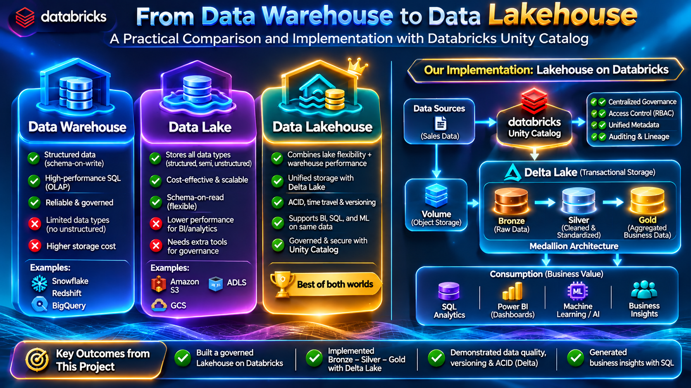

# Data Warehouse vs Data Lake vs Lakehouse: From Architecture to a Practical Databricks Implementation

> Understanding how modern data storage architectures evolved — and building a governed Lakehouse with Unity Catalog, Delta Lake, and the Bronze–Silver–Gold architecture.

## Overview

Every dashboard, machine learning model, or business report eventually depends on one fundamental question:

**Where does the data live, and how is it organized?**

For years, Data Warehouses have been the foundation of business analytics. As organizations began generating larger volumes of semi-structured and unstructured data, Data Lakes emerged as a more flexible and scalable alternative. But that flexibility introduced new challenges around reliability, governance, and analytics performance.

This is where the **Data Lakehouse** architecture becomes interesting.

In this project, I compared Data Warehouse, Data Lake, and Lakehouse architectures and then implemented a practical e-commerce Lakehouse using **Databricks, Unity Catalog, Delta Lake, and Medallion Architecture**.

## Practical Implementation

- Raw dataset: **1,510 e-commerce sales records**
- Storage: **Unity Catalog Volume**
- Bronze: Raw Delta table
- Silver: **1,494 cleaned and standardized records**
- Gold: Business-ready aggregated metrics
- Reliability: Delta Lake transaction history and versioning
- Analytics: SQL-based category, regional, and sales analysis

## Architecture Comparison

*Data Warehouse vs Data Lake vs Lakehouse — conceptual comparison and the architecture used for this project.*

## Full Technical Article

I documented the complete concepts, implementation, screenshots, business insights, trade-offs, and key learnings in my technical article on Medium.

**Read the full article:** [Data Warehouse vs Data Lake vs Lakehouse: From Architecture to a Practical Databricks Implementation](https://medium.com/@gunavardhanrao8/data-warehouse-vs-data-lake-vs-lakehouse-from-architecture-to-a-practical-databricks-a2b9e5f7d1c9)

## What I Implemented

The practical workflow followed:

**Raw CSV → Unity Catalog Volume → Bronze → Silver → Gold → SQL Analytics**

### Bronze Layer

The raw e-commerce dataset was ingested into a Delta table with **1,510 records**.

Data-quality analysis identified:

- 1,500 unique Order IDs
- 3 missing Customer IDs
- 2 missing Product Names
- 4 invalid quantities
- 2 negative sales records
- Inconsistent categorical values

### Silver Layer

The Silver transformation:

- Removed duplicate Order IDs
- Removed invalid transaction records
- Standardized Region
- Standardized Product Category
- Standardized Sales Channel
- Standardized Payment Method

Final validation produced:

- **1,494 total records**
- **1,494 unique orders**
- **0 invalid quantities**
- **0 negative sales**
- **4 standardized regions**
- **5 product categories**
- **2 sales channels**

### Gold Layer

The Gold layer aggregated the trusted Silver data by:

- Year
- Month
- Region
- Product Category

Business-ready measures included:

- Total Orders
- Total Quantity Sold
- Total Sales Revenue
- Average Order Value

## Key Business Insights

- **1,494 orders**
- **5,195 units sold**
- Approximately **₹12.23 million** total sales revenue
- Approximately **₹8,184.89** average sales value per order
- **Furniture** generated the highest category revenue at approximately **₹5.27 million**
- **West** was the highest-performing region at approximately **₹3.32 million**
- **South** recorded the lowest regional revenue at approximately **₹2.52 million**

## Key Learnings

1. **Data Warehouses** are highly effective for structured BI and reporting workloads.
2. **Data Lakes** provide flexibility for storing diverse data at scale but require strong governance.
3. **Lakehouse architecture** combines flexible storage with reliable analytical tables and can support BI, data engineering, and ML workloads.
4. **Delta Lake** provides capabilities such as ACID transactions and table versioning.
5. **Unity Catalog** provides centralized organization and governance for data assets.
6. Bronze, Silver, and Gold layers provide a practical way to progressively transform raw data into trusted business information.

## Technology Used

- Databricks
- Databricks SQL
- Unity Catalog
- Delta Lake
- Medallion Architecture
- SQL

## Repository Structure

    day-03/
    ├── Blog-02-Data-Warehouse-vs-Data-Lake-vs-Lakehouse.md
    └── diagrams/
        └── storage-architecture-comparison.png

## Three Key Takeaways

1. **There is no single architecture that is best for every workload.**
2. **A Lakehouse brings data flexibility and analytical reliability closer together.**
3. **Technology alone does not create trusted data — data quality, governance, and good architecture remain essential.**

## Medium Article

For the complete article with the architecture comparison, practical implementation, screenshots, Delta Lake versioning, business insights, and detailed explanation:

[**Read the complete technical article on Medium**](https://medium.com/@gunavardhanrao8/data-warehouse-vs-data-lake-vs-lakehouse-from-architecture-to-a-practical-databricks-a2b9e5f7d1c9)
